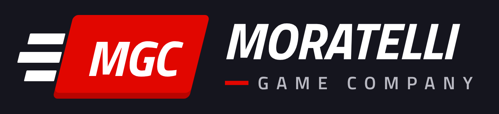

<p align="center"></p>

# PitWall Racing Simulator

**Uma produção Moratelli Game Company (MGC).** Versão publicada: **0.8.7**. Em desenvolvimento: **0.9** (aprimoramento e reconstrução, branch `v0.9-aprimoramento`; ver [CHANGELOG.md](CHANGELOG.md)).

Simulador de gestão de automobilismo para **Windows 10 e 11 (64 bits)**, em português e inglês.

- **Dois modos:** Manager (você comanda uma equipe de F1) e Observador (acompanha o universo sem interferir).
- **Universo vivo:** 23 categorias simuladas ao mesmo tempo (F1, F2, F3, F1 Academy, regionais, F4s, Fórmula E, IndyCar, Super Formula, WEC, DTM, Stock Car e NASCAR), kart na base da pirâmide e cerca de 1.400 pilotos reais com a carreira de 2022 a 2027.
- **Disciplinas:** Monoposto, GT e Endurance, com experiência e adaptação de cada piloto.
- **Fim de semana completo:** treinos com acerto, classificação ao vivo, corrida volta a volta com pneus e energia, Safety Car, Sprint e pódio.
- **P&D por peça:** túnel de vento e CFD com cota do regulamento, pesquisa do carro do ano seguinte e fabricação peça a peça para cada carro.
- **Calendário por dia:** decisões e mensagens importantes precisam de atenção antes de avançar.
- **Mercado e pessoas:** contratos com cláusulas, academias, olheiros com potencial oculto, empresários e patrocínio pessoal.
- **Regulamento vivo:** Conselho da FIA e regulamentos novos que mexem no grid.
- **Circuitos:** licenças pela lista oficial da FIA, circuitos reserva, traçados reais e gerador de circuitos.
- **Mídia:** notícias, rede social, artes automáticas no estilo das redes e eventos raros com personagens fictícios.
- **Base 100% editável** (regras, regulamentos, equipes, pilotos, pistas, motores, calendário e categorias), com importação e exportação em JSON.

> Projeto de fãs, sem relação com a Fórmula 1, a FIA, equipes, pilotos ou empresas reais. Os acontecimentos do jogo são fictícios.

## Instalar
Baixe `PitWall-Racing-Simulator-Setup-<versão>.exe` em **Releases** (ou no artefato da última
execução do GitHub Actions) e execute-o. O jogo cria atalhos na área de trabalho e no menu Iniciar.
Não precisa de internet, navegador nem ferramentas de desenvolvimento.

Saves: `%APPDATA%\PitWall Racing Simulator\saves`. São preservados ao atualizar ou desinstalar.

Se a tela piscar, travar ou mostrar falhas de imagem, desligue **Aceleração de hardware** em *Salvar e opções* (vale ao reabrir o jogo).

## Desenvolver
Requisitos: **Node.js 26** (LTS ativo; versão em `.nvmrc`) e Windows para gerar o instalador.
```
npm ci                                 # dependências nas versões exatas do package-lock.json
npm run dev                            # jogo com ferramentas de desenvolvedor
npm test                               # guardas, privacidade, CI, regras, idiomas e simulação prolongada
node scripts/determinism-check.js      # as 4 carreiras de referência têm de dar a mesma assinatura
node scripts/save-compat-check.js      # saves reais da 0.8.4 à 0.8.7 abertos na versão atual
npm run build && node scripts/ui85-check.js 2   # interface (Playwright)
npm run test:smoke                     # testa o aplicativo real
node scripts/perf-check.js 15 --electron        # desempenho da corrida ao vivo no aplicativo
node scripts/freshness-check.js        # software atualizado e sem avisos de segurança
npm run dist                           # gera o instalador (no Windows)
```
Guia para o Claude Code em [CLAUDE.md](CLAUDE.md).
Índice da documentação em [docs/README.md](docs/README.md). Detalhes em [docs/ARQUITETURA.md](docs/ARQUITETURA.md), regras do projeto em [docs/DESENVOLVIMENTO.md](docs/DESENVOLVIMENTO.md) e histórico de versões em [CHANGELOG.md](CHANGELOG.md).

## Marca
Logo da Moratelli Game Company, ícone, tela de abertura e imagens do instalador são gerados por
`node scripts/make-brand.js` (fontes do jogo + Chromium). Peças em alta resolução em `docs/brand/`.

## Créditos dos dados
- Resultados, pilotos, equipes e circuitos de 1950 até hoje: [f1db](https://github.com/f1db/f1db) (CC BY 4.0).
- Fotos de pilotos, carros, logos e mapas oficiais: formula1.com (uso em desenvolvimento; a versão comercial precisará de licença ou de imagens próprias).
- Geometria real dos circuitos: [bacinger/f1-circuits](https://github.com/bacinger/f1-circuits) (MIT).
- Outras categorias e base de pilotos 2022–2027 (grids, calendários e classificações): Wikipedia (CC BY-SA); nascimento, nacionalidade e redes sociais: Wikidata (CC0); fotos: sites oficiais e Wikimedia Commons (licença de cada arquivo em `app/assets/img/sources.json`).
- Circuitos licenciados: lista oficial da FIA; traçados de circuitos de Grau 2: © colaboradores do OpenStreetMap (ODbL).
- Para atualizar os dados: `scripts/import_real_data.py`, `import_records.py`, `import_categories.py`, `import_drivers.py`, `import_images.py`, `import_logos.py`, `import_fia_circuits.py` e `import_real_tracks.py`.
