# Dossiê de UI e design — proposta para a V0.8.5

Data: 08/11/2026. Pedido do dono: um dossiê completo sobre o design do jogo, cobrindo:
- os problemas e tudo o que hoje faz o jogo parecer feio e "feito por IA, de bate-pronto";
- ideias, melhorias, erros e inspirações;
- imagens que mostrem as propostas.

As imagens estão em `docs/ui-085/`:
- **antes:** 30 telas capturadas do jogo atual, numa carreira com 6 GPs;
- **depois:** maquetes de alta fidelidade feitas com as fontes, fotos, carros e traçados reais do próprio jogo.

---

## 1. Diagnóstico em uma frase

O PitWall tem a profundidade de um Football Manager, mas a cara de um painel administrativo. As telas são formulários e tabelas organizados em caixas escuras iguais, sem hierarquia, sem momentos de emoção e sem identidade da equipe que o jogador comanda.

## 2. Por que o jogo parece "jogo de IA de bate-pronto"

São padrões que o olho reconhece na hora como "gerado". Os 12 que mais pesam:

| # | Padrão | Onde aparece | Por que incomoda |
|---|---|---|---|
| 1 | **Toda tela tem a mesma estrutura:** título gigante em caixa alta, depois uma grade de caixas escuras com borda fina | As 30 telas | Nada guia o olho; tudo tem o mesmo peso. Parece um modelo repetido, não um produto desenhado |
| 2 | **Parágrafos explicando a regra no topo da tela** | Conselho, Donos, Sede e fábrica, Fabricantes, Olheiros, Circuitos | Explicar a mecânica em texto corrido é a marca mais clara de interface gerada. Jogo bom ensina com ícone, dica contextual e estado visual |
| 3 | **Menu lateral com cerca de 30 itens soltos**, todos do mesmo tamanho | Todas as telas | Sobrecarga. O Football Manager tem 9 áreas, o F1 Manager tem 6 |
| 4 | **Barra superior vermelha chapada** com indicadores pequenos | Todas | Cansa a vista, compete com o botão principal e não diz o que é bom ou ruim ("Diretoria 59%": isso é bom?) |
| 5 | **Números crus, sem cor nem tendência** | Classificação, Finanças, Equipe, Comparativo do grid | O jogador precisa ler cada número para entender. Falta escala de cor, seta de tendência e mini gráfico |
| 6 | **Barras de atributo sempre vermelhas**, com a mesma cor para 74 e para 93 | Equipe, ficha do piloto | A cor deveria ser a informação (verde bom, amarelo médio, vermelho fraco). Hoje é só enfeite |
| 7 | **Mistura de linguagens visuais:** fotos reais, avatares de desenho, fotos de banco de multidão, artes de carro em PNG e controles padrão do navegador | Central, Equipe, Notícias, Opções | Nada parece pertencer ao mesmo jogo |
| 8 | **Controles padrão do navegador:** caixas de seleção, menus suspensos, controles deslizantes e checkboxes sem estilo | Opções, Treino livre (acerto), Mercado, Academia | O sinal mais forte de "protótipo" |
| 9 | **Estados vazios sem ação:** caixas enormes com uma frase cinza ("Nenhuma votação aberta", "Nada ainda", "A primeira temporada ainda está em andamento") | Conselho, Histórico, Fabricantes, Donos | Espaço desperdiçado que parece tela quebrada |
| 10 | **Excesso de separadores e siglas** ("·", "pts", "V", "Pód.", "VMR") e mistura de idiomas ("Pace", "Sprint") | Toda a interface | Leitura truncada e técnica |
| 11 | **Sem momentos de emoção:** largada, vitória, título e contratação passam como uma linha de texto ou um card pequeno | Pós-corrida, pódio, fim de temporada, Mercado | Um jogo de gestão vive desses picos (o F1 Manager tem pódio em 3D; o FM tem a festa do título) |
| 12 | **Densidade irregular:** tabelas com 30 colunas minúsculas ao lado de cards gigantes quase vazios | Classificação, Comparativo do grid, Donos, Pós-corrida | A tela não tem ritmo |

## 3. Problemas por tela

| Tela | Problemas | Proposta |
|---|---|---|
| **Central** (`ui-085/antes-hub.png`) | 1. Barra vermelha pesada. 2. Menu de 30 itens. 3. Título "Central da equipe" ocupa 80 px sem informação. 4. Foto genérica de multidão com o traçado por cima. 5. Ficha técnica do circuito com barras vermelhas sem escala. 6. As 3 decisões pendentes escondidas atrás de um botão "Abrir", com o "Avançar" apagado. 7. Duas listas de classificação longas e iguais | Herói da próxima etapa com foto do circuito, programação do fim de semana e contagem regressiva. Decisões pendentes com o botão de ação na própria linha. Cartões dos dois pilotos, torre do campeonato no estilo da TV, 4 indicadores com mini gráfico. Botão "Avançar" sempre visível no topo (`ui-085/depois-hub.png`) |
| **Caixa de entrada** | Lista e leitura em duas colunas sem prioridade visual. O selo "decidir" é pequeno. Sem filtros por tipo | Filtros por área (equipe, mercado, regulamento, fábrica), cores de prioridade e respostas rápidas na própria lista |
| **Classificação** (`ui-085/antes-standings.png`) | 1. Título enorme. 2. Matriz de resultados por GP com números de 11 px sem cor de pódio nem de pontos. 3. A sua linha mal se destaca | Torre no estilo da TV (faixa de cor da equipe, tendência), matriz com cores (ouro, prata, bronze, verde para pontos, cinza fora dos pontos, rosa para abandono) e a sua equipe fixa no topo |
| **Calendário** | Lista de 24 linhas; não existe visão por mês | Grade mensal no estilo F1 Manager, com eventos de todas as categorias, prazos do mercado, obras e reuniões (`ui-085/depois-calendar.png`) |
| **Equipe / pilotos** (`ui-085/antes-team.png`) | 1. Título. 2–3. Atributos em barras vermelhas iguais. 4. Contrato em texto corrido monoespaçado e quebrado ("empresário: Jacques Heckstall-Smith (Grip Sports Management) (comissão de 8%)") | Cartões de piloto com cor da equipe, anel de nota, atributos em escala de cor e o contrato em selos (`ui-085/depois-driver.png`) |
| **Ficha do piloto** (`ui-085/antes-driver.png`) | 1. Abre numa janela estreita sobre outra tela. 2. Atributos todos vermelhos. 3. Bloco de texto denso | Página própria, com herói na cor da equipe, foto recortada, número grande, nota e potencial, atributos agrupados com escala de cor, forma da temporada, carreira e contrato (`ui-085/depois-driver.png`) |
| **Carro e P&D** | Foto do carro solta; lista de barras; "vagas" como caixas cinzas | Planta do carro com as peças clicáveis (asa dianteira, assoalho...) e a fila de projetos como linha do tempo, com prazo e risco |
| **Sede e fábrica** | Tabela com 12 linhas e botões | Campus visual: cada prédio com nível, estado e obra, e o painel do selecionado com comparação com o grid (`ui-085/depois-campus.png`) |
| **Finanças** | Números gigantes sem contexto; gráfico pequeno | Fluxo de receitas e despesas (cascata), teto como barra com marcos e projeção do ano |
| **Mercado** | Tabela única de 120 pilotos com texto de contrato longo | Filtros laterais, cartões compactos, comparação lado a lado e "lista de observação" |
| **Conselho da FIA** | Parágrafo de regras; estado vazio grande | Painel de votação com placar ao vivo, blocos por fornecedora e as concessões em destaque |
| **Notícias** | É a tela mais bonita hoje (manchete com foto) | Manter. Padronizar as artes geradas e dar mais espaço às redes sociais |
| **Equipes do grid** | Cartões grandes com muitos números iguais | Comparador com o carro e as 4 áreas em gráfico de radar |
| **Donos, Fabricantes, Registro, Circuitos** | Tabelas e parágrafos | Linha do tempo visual (vendas, entradas, motores), cartões de fabricante com logo e mapa de circuitos |
| **Fim de semana / acerto** | Controles deslizantes padrão, muito texto de engenharia | Acerto visual: o carro com as partes reguláveis e o retorno do piloto em balões ("sai de frente na curva 10") |
| **Corrida ao vivo** | Boa base (torre, mapa, comandos), mas o mapa é pequeno, a torre não tem a faixa de cor da equipe, os comandos ficam escondidos e a bandeira é um selo pequeno | Torre no estilo F1 TV, mapa grande com setores, cartões de comando dos seus dois pilotos (pneu, energia, box, rádio) e a bandeira na barra do topo (`ui-085/depois-race.png`) |
| **Pós-corrida / pódio** (`ui-085/antes-post.png`) | 1. Pódio de blocos chapados dentro de uma caixa, com muito espaço vazio. 2. Título enorme repetindo a manchete. 3. Resultado da sua equipe em cards soltos | Pódio cheio de tela com as fotos e cores das equipes, confete e hino, e depois a análise: resumo da sua corrida, pontos, diretoria e destaques |
| **Tela inicial** | Foto real de Las Vegas com marcas reais (licença) e o diálogo de idioma por cima | Arte própria do jogo, menu limpo e últimos saves com a cor da equipe |
| **Opções** | Checkboxes e selects padrão; texto longo | Seções com chaves estilizadas e prévia ao vivo |

## 4. Erros visuais encontrados na revisão

1. **Ficha do piloto em janela modal estreita:** cobre a tela da equipe, o texto do contrato quebra e é preciso rolar dentro da janela.
2. **Ações de piloto com 4 versões:** `ACT.driverPage` é definida em 4 arquivos e vale a última. Hoje funciona, mas é frágil: qualquer mudança numa delas pode não ter efeito.
3. **Funções de interface duplicadas** (`updateRace`, `flagHtml`, `speedMs`, `lapChartHtml`, `stepsHtml`, `edCalendar`, `fmtRaceTime`): a última declarada vale para o jogo inteiro. Não quebram, mas confundem quem mexe no código.
4. **Formatação de números inconsistente:**
   - "$89.7M" ao lado de "US$ 1,2 mi";
   - "87.3/86" sem casa decimal no segundo número;
   - "$0K" em vez de "—";
   - pontos e vírgulas misturados conforme a tela.
5. **Diálogo de idioma** aparecendo por cima da tela inicial em toda primeira abertura, sem fundo escurecido.
6. **Botão "Avançar" apagado sem dizer o porquê na mesma área** (o aviso de decisões fica em outro bloco).
7. **Contraste baixo:** texto cinza de 11–12 px sobre fundo quase preto, abaixo do mínimo recomendado de leitura (WCAG AA) em várias telas.
8. **Fotos com fundo branco** recortadas em círculo e avatares de desenho no mesmo grid.

## 5. Inspirações e o que pegar de cada uma

| Referência | O que aproveitar |
|---|---|
| **F1 Manager 2024** | Central com a próxima etapa em destaque e o calendário em faixa; ficha do piloto com foto grande e cor da equipe; P&D com a planta do carro; corrida com a torre de transmissão |
| **Football Manager 2024** | Navegação por poucas áreas com abas internas; caixa de entrada como centro de decisões; atributos em grade com escala de cor; comparação lado a lado; busca universal |
| **Motorsport Manager** | Sede como campus visual com prédios clicáveis; interface plana e colorida pela equipe; fabricantes de motor com peças e contratos claros |
| **Grafismo da F1 na TV e formula1.com** | Faixa de cor da equipe, siglas de 3 letras, ícones de pneu, roxo para volta mais rápida, títulos em itálico pesado só onde importa |
| **EA FC / Ultimate Team** | Cartões de jogador colecionáveis, com nota grande e cores por raridade (aqui: nível estimado pelo olheiro) |
| **Painéis modernos de dados (Linear, Stripe)** | Tabelas limpas, números alinhados, mini gráficos de tendência, estados vazios com ação |

## 6. Proposta

### 6.1 Princípios
1. **Uma ação principal por tela**, sempre no mesmo lugar: o botão "Avançar" no canto superior direito.
2. **A cor da equipe do jogador conduz a interface:** destaques, a sua linha nas tabelas, gradientes dos heróis.
3. **Todo dado tem forma:** cor por faixa, seta de tendência, mini gráfico ou ícone. Número cru só onde a precisão importa.
4. **Ensinar sem parágrafo:** ícone de ajuda (?) com dica contextual e um "como funciona" opcional por tela.
5. **Momentos de emoção:** largada, pódio, título, contratação, obra concluída e escândalo têm tela ou animação própria.
6. **Densidade com ritmo:** um bloco de destaque por tela e o resto em cartões menores.

### 6.2 Navegação nova
- **Trilho lateral compacto com 10 áreas:**
  - Início, Mensagens, Corrida, Equipe, Carro, Fábrica, Mercado, Finanças, Mundo, Dados;
  - as 30 telas atuais viram abas dentro dessas áreas.
- **Busca universal (Ctrl+K)** para abrir qualquer tela, piloto ou equipe.
- **Barra superior escura:** a equipe, 3 indicadores com cor e tendência e o botão "Avançar".

### 6.3 Sistema visual (`ui-085/depois-system.png`)
- **Cores:**
  - superfícies carbono (#0B0C10, #13151B, #1A1D25);
  - vermelho da marca (#E10600) só para ação principal e alertas;
  - cor dinâmica da equipe;
  - semânticas: verde #2BD67B, amarelo #FFC93C, rosa #FF3B6B, roxo #B46BFF para mais rápido.
- **Tipografia:**
  - Titillium 900 itálico só em títulos de impacto (nome do GP, nome do piloto);
  - Titillium 400/600/700 de 14–15 px para o resto;
  - IBM Plex Mono para todos os números (tempos, dinheiro, notas).
- **Componentes:**
  - anel de nota;
  - selos de estado;
  - ícones de pneu S/M/H/I/W;
  - faixa de cor da equipe na torre;
  - barras de atributo com escala de cor;
  - cartões de decisão com ação direta;
  - indicadores com mini gráfico;
  - estados vazios com ilustração e ação.
- **Grade de 8 px**, cantos de 10 px e no máximo dois níveis de sombra.

### 6.4 Telas-chave redesenhadas (maquetes)
| Maquete | O que mostra |
|---|---|
| `ui-085/depois-hub.png` — Central | Herói da próxima etapa, decisões com ação, cartões dos pilotos, torre do campeonato, indicadores com tendência |
| `ui-085/depois-race.png` — Corrida | Bandeira na barra, torre estilo TV com tendência e pneus, mapa grande com setores e carros, cartões de comando dos seus dois pilotos, direção de prova e rádio |
| `ui-085/depois-driver.png` — Ficha do piloto | Herói na cor da equipe, nota e potencial estimado, atributos em escala de cor, carreira, forma, contrato em selos |
| `ui-085/depois-campus.png` — Sede e fábrica | Campus com os prédios, nível, estado, obra em andamento, painel do prédio selecionado e comparação com o grid |
| `ui-085/depois-calendar.png` — Calendário mensal | Mês inteiro com F1, categorias de base, Conselho, peças novas e prazos, com filtros |
| `ui-085/depois-system.png` — Sistema visual | Paleta, tipografia e componentes |

### 6.5 Imagens e licenças (pensando na versão comercial)
- **Avatares e fotos:**
  - parar de misturar avatares de desenho com fotos reais;
  - na versão comercial, toda pessoa será fictícia, então o caminho é retrato ilustrado num estilo único.
- **Tela inicial:** foto de Las Vegas com marcas reais; trocar por arte própria.
- **Carros:** gerar pinturas próprias a partir de um modelo 3D ou de uma vista lateral única, para que as equipes criadas e as candidatas tenham carro.

### 6.6 Movimento, som e acessibilidade
- **Movimento:**
  - transições de 150 ms entre telas;
  - números que contam até o valor;
  - bandeiras animadas na corrida;
  - pódio com confete.
- **Som:** sons curtos de interface (confirmar, erro, notificação), separados dos sons de corrida, cada um com controle de volume.
- **Acessibilidade:**
  - texto mínimo de 13 px e contraste AA;
  - foco visível no teclado;
  - opção de escala da interface (90%, 100%, 115%, 130%);
  - modo de cores para daltonismo nos pneus e nas faixas.

## 7. Plano de execução da V0.8.5

| Fase | Entrega |
|---|---|
| 1. Base | Tokens de cor e tipografia, biblioteca de componentes, trilho lateral, barra superior e busca Ctrl+K |
| 2. Telas que o jogador vê toda semana | Central, Caixa de entrada, Corrida ao vivo, Pós-corrida e pódio, Classificação |
| 3. Gestão | Ficha do piloto (página própria), Equipe, Carro e P&D (planta), Sede e fábrica (campus), Calendário mensal, Mercado, Finanças |
| 4. Mundo e dados | Notícias, Conselho, Donos, Fabricantes, Registro, Circuitos, Categorias, História |
| 5. Acabamento | Movimento, sons de interface, acessibilidade, escala da interface, revisão do inglês, capturas para a loja |

## 8. Decisões que preciso de você antes de começar
1. **Direção visual:** aprova a linha das maquetes (carbono, cor da equipe e grafismo de transmissão)? Ou prefere algo mais claro ou mais "videogame"?
2. **Navegação:** aprova trocar o menu de 30 itens pelo trilho de 10 áreas com abas e busca?
3. **Retratos:** para a versão comercial, que será fictícia, prefere retrato ilustrado (estilo único) ou foto gerada realista?
4. **Prioridade:** começo pela Central e pela Corrida (o que mais aparece) ou por outra tela?
5. **Canva:** a apresentação da direção visual está na sua conta do Canva para editar. Se quiser, use-a para marcar o que mudar antes da implementação.

## Imagens

### Antes (telas atuais com marcações)
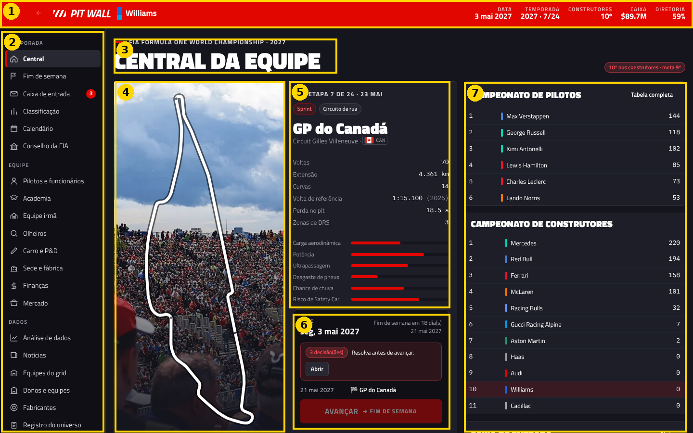
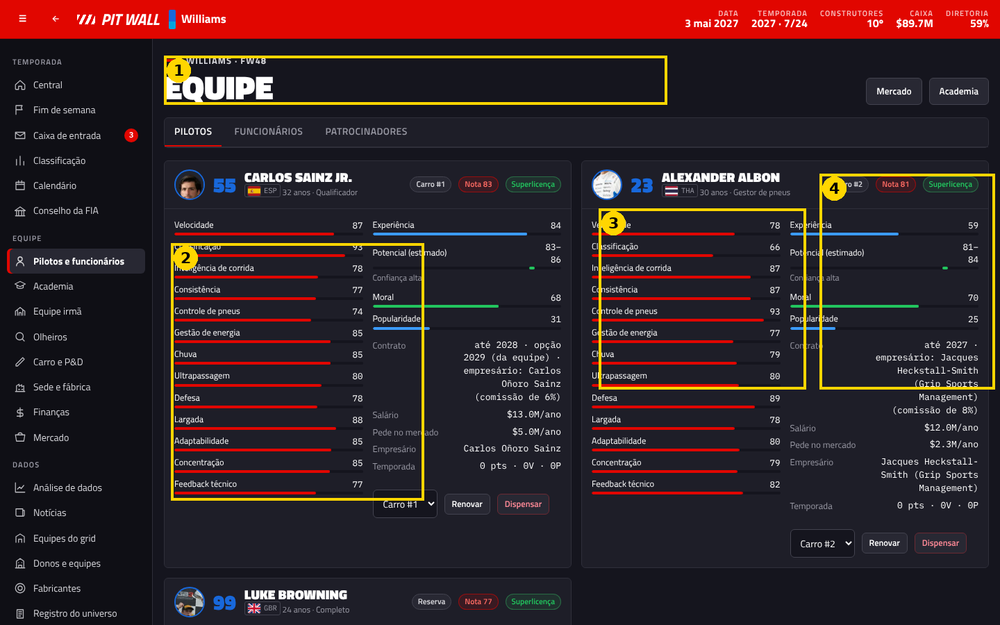
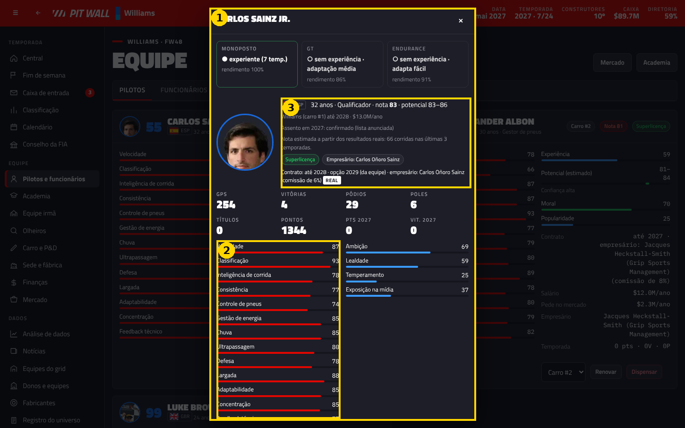
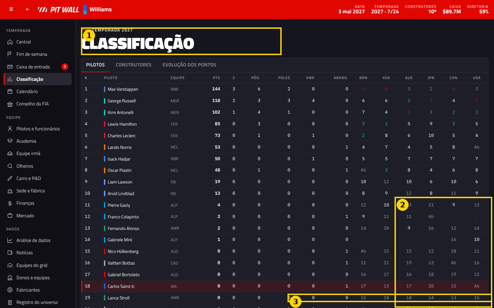
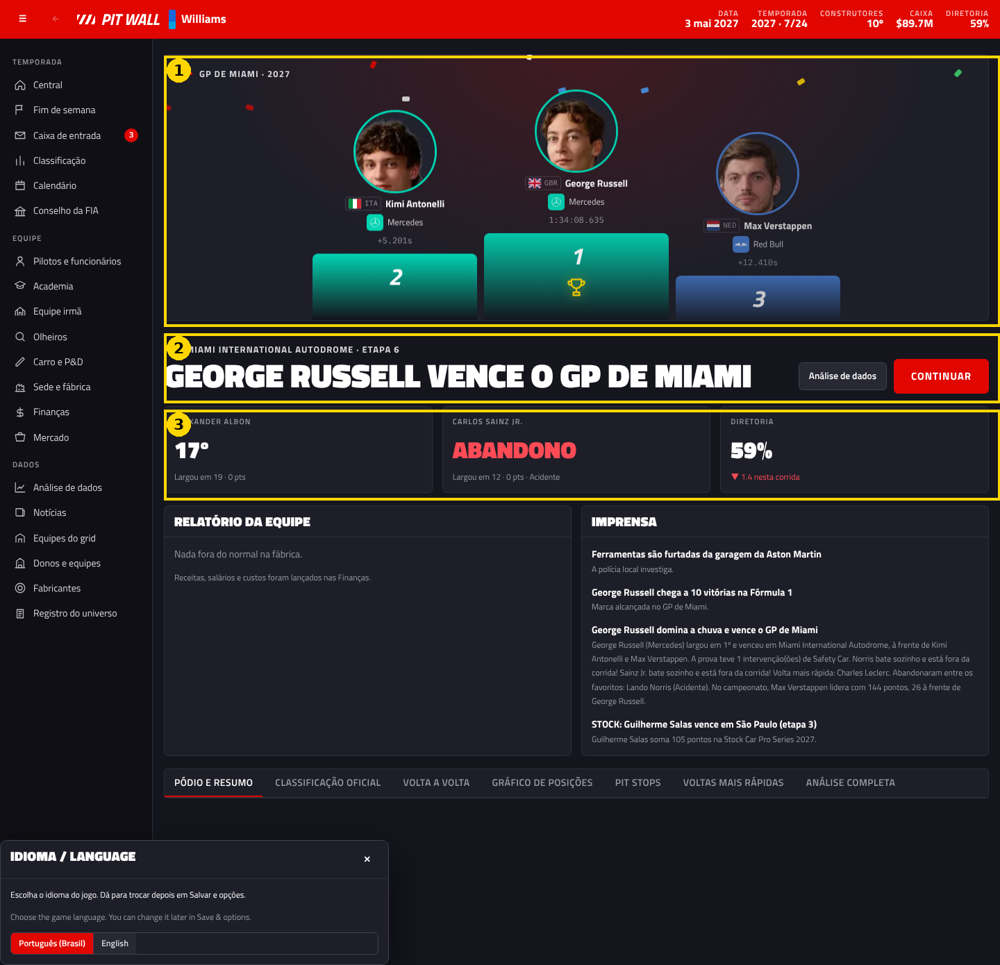

### Depois (maquetes)
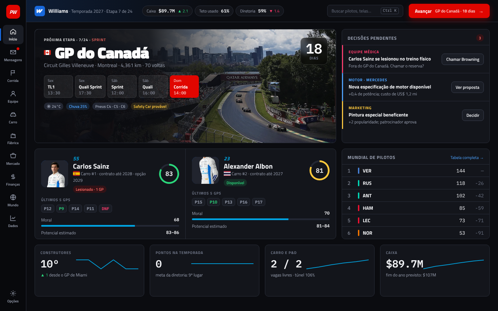
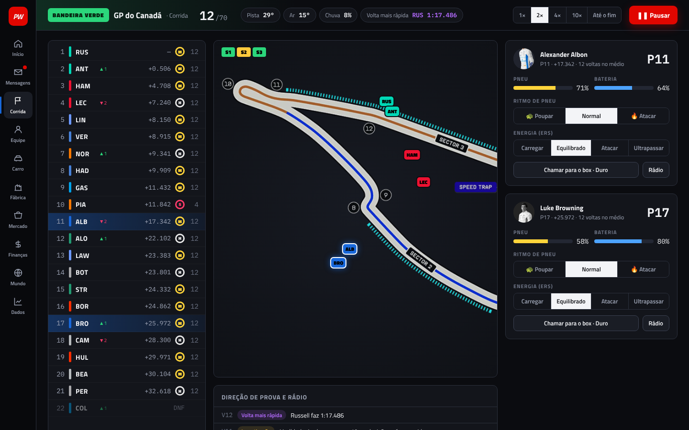
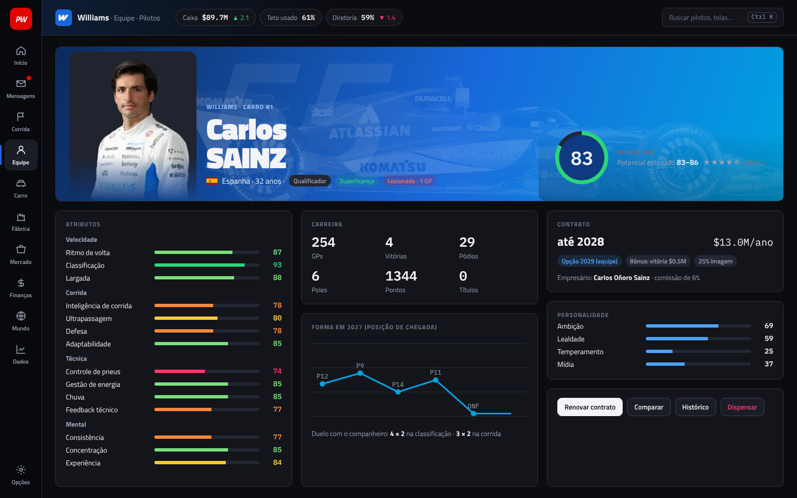
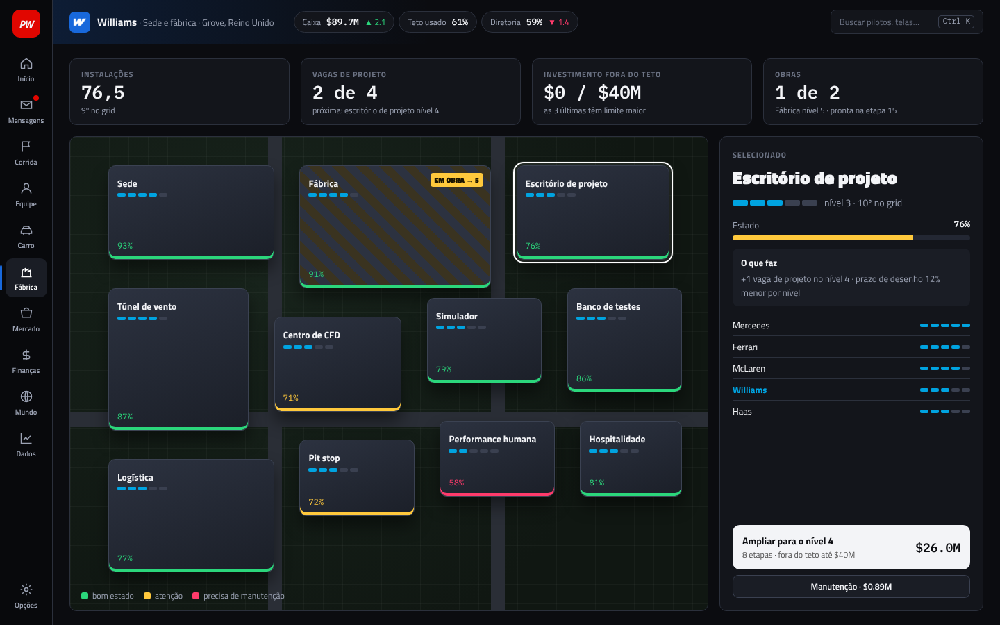
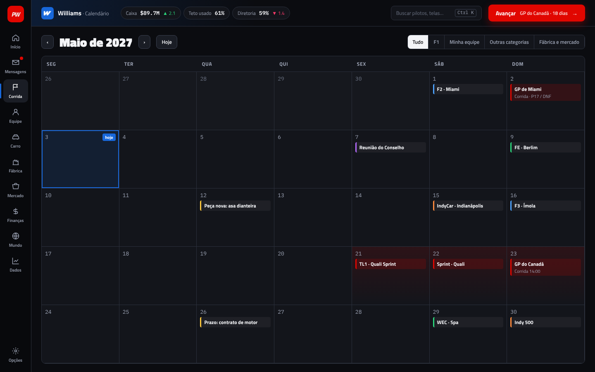
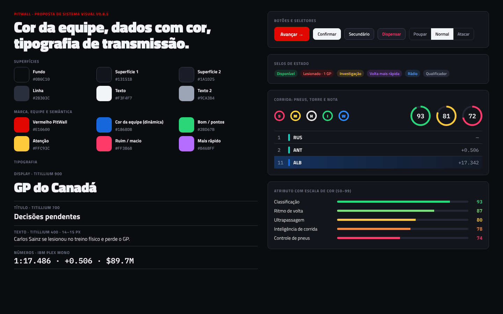

Apresentação no Canva (editável): https://canva.link/heszcl2fu1srpwy
